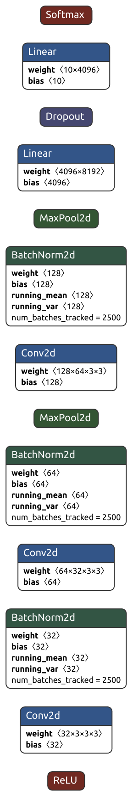
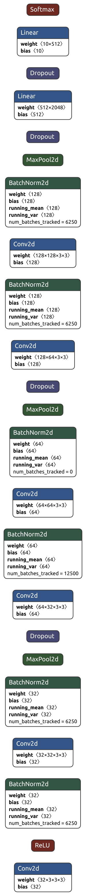
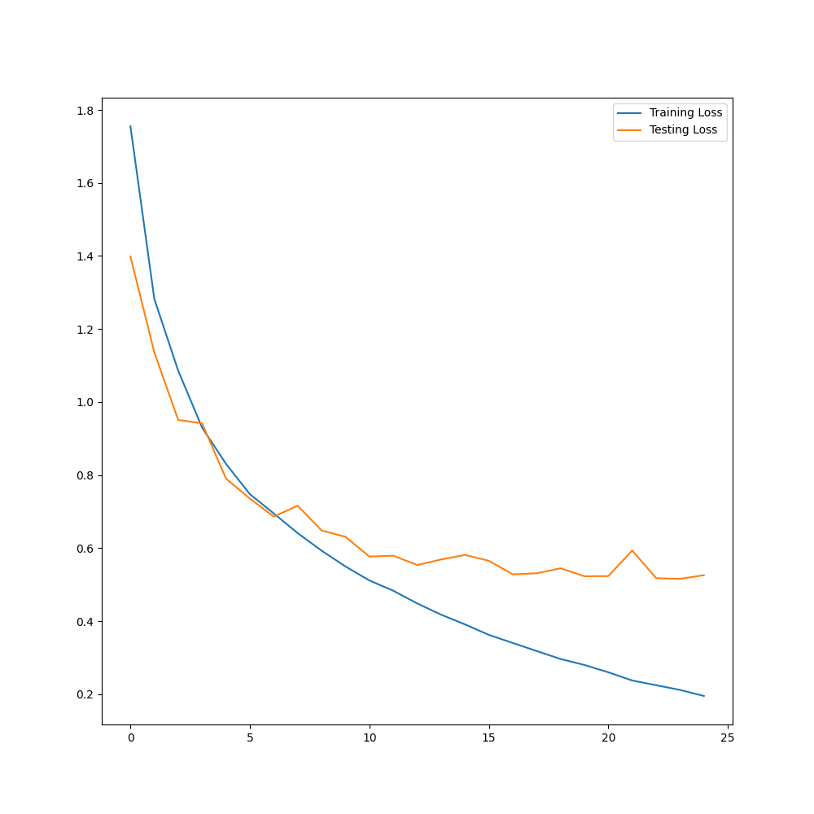
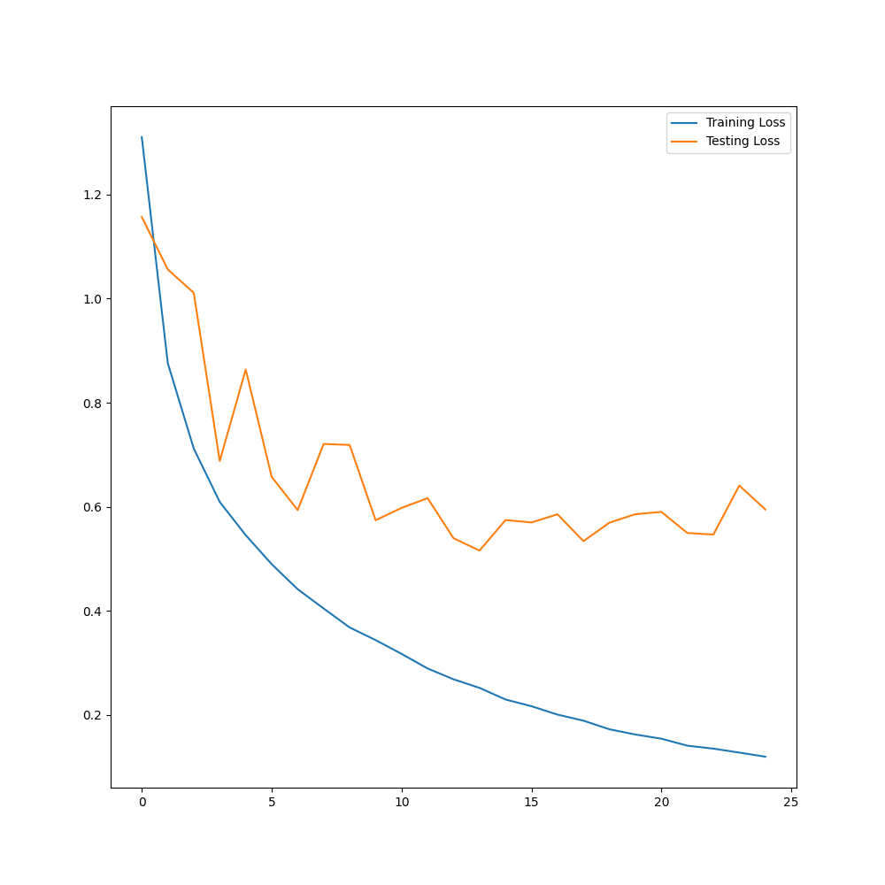

## General Info

- In this repository, two CNN model is trained with two difference CNN architectures. One of the architecture is developed by the authors, the other architecture is taken from kaggle and  optimized by the authors. The aim of the repository is having more than %80 accuracy.

## CNN Architectures

### Unique CNN Architecture
<div align="center">
  
</div>


### Optimized CNN Achitecture

<div align="center">
  
</div>


## Loss Graphs of The Models

- The Loss Function of he unique model.

<div align="center">
  
</div>

- The Loss Function of he optimized model.

<div align="center">
  
</div>


## Conda Environment Setup Steps
```bash
conda create --name cnn-cifar-pytorch python==3.8
```
```bash
conda activate cnn-cifar-pytorch
```

```bash
pip install --upgrade pip wheel setuptools
```

- Torch installation with CUDA is depends on your CUDA version.You can follow the download steps with  the [LINK](https://pytorch.org/get-started/locally/)


- To learn CUDA version
```bash
nvidia-smi
```

For CUDA 12.1
```bash
pip3 install torch torchvision torchaudio
```

For CUDA 11.8
```bash
pip3 install torch torchvision torchaudio --index-url https://download.pytorch.org/whl/cu118
```


```bash
pip install -r requirements.txt
```

## Usage
 
- To run code to train the model
```bash
python app.py --env local -t
```

- To run code to test inference performance of the model
```bash
python app.py --env local -i
```

- To run code to test inference performance of the model after training
```bash
python app.py --env local -t -i
```
