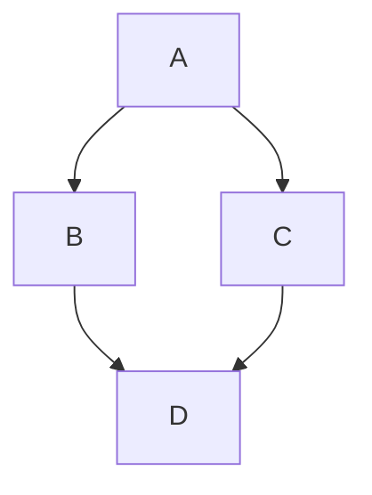

## Installation
```bash
```

## Usage
```bash
```

## Docker Build
```bash
```

## Docker Run
### Debug
```bash
```
### Prod
```bash
```

## Docker-Compose Run
```bash
docker-compose up --build
```

## Flowchart
